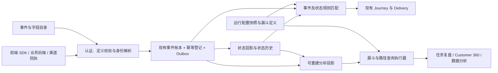

# 瑶光营销平台：可配置业务状态、事件与全链路漏斗

日期：2026-09-07

状态：供评审的架构设计草案；尚未实施，尚未获得设计确认。

代码核查基线：`main`，`738bc6dc`。本文中的新增对象、接口和页面均为拟议能力。

## 1. 目标与关键结论

围绕一个稳定的 Customer，管理多种联系方式、用户配置的业务对象、可并存的业务状态、每一次业务事件，以及营销活动到业务结果的完整转化过程。运营人员能够配置业务对象及关联、事件及字段、状态及生成规则、任务关注的指标和触发条件，并通过拖拽构建可复用的漏斗与路径分析。

不能把所有业务信息继续塞入一个 `status` 字符串。需要明确五类不同事实：

| 类别 | 回答的问题 | 示例 | 归属与关系 |
| --- | --- | --- | --- |
| 身份和触达地址 | 是谁、如何联系 | 身份证对应身份、手机号、邮箱、WhatsApp | 一个 Customer 可关联多个身份和地址 |
| 业务状态 | 某时点具有什么特征 | 已实名、已授信、会员有效、当前逾期 | 独立状态可重叠，可以全部不满足；按客户或业务对象保存 |
| 业务事件 | 某时刻发生了什么 | 提交资料、授信通过、放款成功、收到还款 | 每次发生独立记录，允许重复业务行为 |
| 触达与订阅状态 | 某次消息怎么样、能否继续触达 | 已提交供应商、送达、打开、退订 | 归属消息、地址或渠道同意，不能被自定义业务状态覆盖 |
| 分析定义 | 本次要如何衡量 | 注册人数、支用转化率、逾期后回款率 | 引用事件和状态定义，明确对象、时间、归因与分母 |

信贷只是可安装、可编辑的一套业务模板，不把注册、授信、会员或放款写死为平台枚举。

已确认的产品边界：Customer 是内置客户主体；授信申请、借款订单是通过系统配置创建的业务对象类型。平台必须支持按客户及已配置的对象统计，不能硬编码三种统计类型、申请表、借款表或专用申请/借款节点。

后续已确认：Campaign 不做版本管理；每次实际活动运行和自动化营销执行保存可完整查看的运行配置快照。客户唯一主键是 Customer UUID，支持按外部用户 ID 归集身份与合并客户。平台提供默认事件，也支持配置外部字段、客户属性映射、触发时间及失效时间的自定义事件。

## 2. 当前代码与差距

以下是当前文件核查结果，既有设计文档仅作背景，不能代替代码实现证据。

| 已核查位置 | 当前能力 | 本次差距 |
| --- | --- | --- |
| `internal/domain/customer.go` | Customer UUID、外部用户 ID、多身份、Workspace 指纹、合并；`profile.status` 是单字符串 | 补齐可配置客户属性/识别映射、外部用户 ID 合并后的别名解析及多状态定义；客户唯一主键继续为 UUID |
| `console/src/components/customers/CustomerProfilePanel.tsx` | 可编辑状态文本、标签与属性 | 缺少状态目录、状态规则、有效期和历史解释 |
| `internal/domain/custom_event.go`、`internal/repository/custom_event_postgres.go` | CustomEvent 表示外部资源当前状态；请求要求邮箱，按事件名和外部资源 ID 更新；有 customer_id 兼容关联 | 补默认/自定义事件目录、外部字段映射、客户属性关联、上报 ID 幂等与失效时间；不能作为新发生记录的唯一权威 |
| `internal/domain/realtime.go`、`internal/repository/realtime_postgres.go` | EventEnvelope 已有 Customer subject、事件版本、发生时间、接收时间；AppendEvent 同事务写幂等登记、账本和 Outbox | 应复用这套账本，补齐公开接入、定义校验、业务对象关联和分析投影 |
| `internal/domain/automation.go`、`internal/domain/journey.go` | 固定事件类别及 custom_event；已有 once/every_time、Customer 入场去重 | 配置目录驱动的业务事件/状态触发、对象作用域、同一对象等待和循环保护需要扩展 |
| `internal/domain/campaign.go` | CampaignVersion、CampaignRun、Customer 收件人快照 | 按用户要求取消 Campaign 版本管理，转为每次运行的完整配置、条件、素材及执行证据快照；现有版本结构仅作迁移兼容 |
| `web_analytics_sdk/src/index.ts`、`types.ts` | 页面、目标和邮箱签名/不透明 token 身份 | 通用类型化事件、Customer 登录识别和业务对象上下文需要扩展 |
| `internal/domain/web_analytics_schemas.go`、`console/src/components/navigation/DataAnalyticsPageShell.tsx` | 网站会话、页面、目标等分析及共享页签骨架 | 尚无本需求中的通用跨事件顺序漏斗与分支路径设计器 |
| `deploy/clickhouse/init/001_events.sql` | 已有事件与投递分析投影 DDL | 不能据此假定当前环境已启用；新投影需补 Customer、对象关联和查询时去重 |

既有 `custom_events` 的更新还会通过时间线生成账本记录，因此“资源表只保留当前行”不等于所有历史都消失。迁移必须实际检查账本与时间线覆盖，不能直接假设历史完整或完全缺失。

## 3. 实现方案选择

| 方案 | 收益 | 代价与局限 | 结论 |
| --- | --- | --- | --- |
| A. 给现有状态字段增加多选，给 custom_events 增加字段配置 | 初始改动较小 | 资源更新与事件发生混淆，跨对象漏斗和历史时态仍不可靠 | 不满足完整需求 |
| B. 在现有 Customer、事件账本和 Journey 上补配置与分析层 | 复用可靠写入和现有业务模块；可渐进替换邮箱依赖 | 需要设计统一事件协议、状态投影和漏斗执行器 | 推荐 |
| C. 独立建设或接入另一套客户数据/行为分析平台 | 可独立扩容分析 | 双身份、双事件权威、状态回传和任务一致性成本较高 | 当前不作为默认依赖 |

采用 B，拆成“身份与事件底座 → 状态与规则 → 任务跟踪 → 漏斗与路径分析”四个可独立验收的实施包。先约定贯穿四包的协议，避免各模块独立发明事件与去重规则。

## 4. 客户、身份与业务对象

### 4.1 稳定客户 ID

- Customer UUID 是客户唯一主键；全部客户外键、客户级状态与事件归属最终使用该 UUID。客户编号、external_user_id、邮箱、手机号、身份证均不是另一套客户主键。
- 身份证、三要素、邮箱、手机号及用户配置的其他识别属性用于解析 Customer，不直接作为数据库客户主键。属性值是否用于查询、更新画像或绑定身份由接入配置分别声明。
- 身份证身份由国家/地区、证件类型、规范化号码确定命名空间；三要素按姓名、证件、手机号的结构化字段校验，不能通过字符串直接拼接生成键。
- `external_user_id` 是可配置接入的外部识别字段，同时是身份归集及客户合并支持的定位方式；沿用现有 Workspace 内唯一性，不能因来自不同接入源就自动当成不同客户。
- 同一外部用户 ID 上报的邮箱、手机号等身份归到同一 Customer UUID。邮箱、手机号或证件单独上报时，按已配置的身份字段和规范化规则查询，命中唯一客户后关联事件；不要求每次上报全部身份或三要素。
- 已存在多个 Customer 时，支持使用 source.external_user_id 和 target.external_user_id 定位源/目标执行幂等合并；也支持先定位目标外部用户 ID，再将已核实属于该人的身份归入目标。已有 CustomerMergeRequest 的 source/target 都是 CustomerLocator，外部 ID 定位能力应复用。
- 合并保留目标 Customer UUID，源 UUID 通过别名/重定向解析到目标，保留审计与事件原始来源。源客户外部 ID 作为可追溯别名继续解析；规范化外部 ID 在同一 Workspace 内不得同时解析到两个有效 Customer。业务对象、状态、触达和漏斗去重按最终客户关联对账，历史原始事件不覆盖改写。
- 自动归集多身份与合并两个现有 Customer 分别配置。未核实身份、不同外部用户 ID 冲突或多个识别字段指向不同客户时保留可处理冲突；普通画像相似不触发合并。手机号变化不能自动创建新的自然人，手机号/共享设备相同也不能直接证明两个 UUID 应合并。
- 联系地址保留渠道、用途、主次、验证、启用和同意信息。身份匹配成功不自动产生渠道订阅同意。
- 增加 `identity_kind` 和规范化版本，兼容现有 `custom` 类型。敏感值沿用加密保存、Workspace 内带密钥指纹匹配与脱敏响应；本次不改动既有身份指纹算法的兼容语义。

### 4.2 多笔业务的对象关联

用户已在 2026-09-07 确认需要同时按客户及关联业务对象统计，并进一步明确：授信申请、借款订单必须通过系统配置，属于示例而非平台固定形态。每份漏斗选择 Customer 或某个已发布的业务对象类型作为计数对象，并通过已配置关系下钻；整体架构及实施方案仍待评审确认。

新增轻量业务对象类型目录与实例关联，不复制信贷业务系统的账务或审批逻辑：

下表除 Customer 外均为信贷模板的配置示例，类型、名称、唯一键及关系都可由用户创建或调整。

| 对象 | 建议唯一键 | 关系 |
| --- | --- | --- |
| 客户 | customer_id | 可有多次申请、多笔借款 |
| 授信申请 | source_id + application_id | 归属 Customer |
| 借款订单 | source_id + loan_id | 归属 Customer，可关联授信申请 |
| 还款计划/期次 | source_id + loan_id + installment_id | 归属借款订单 |
| 还款交易 | source_id + repayment_id | 通过分配明细关联订单或期次 |
| 自定义对象 | object_type + source_id + external_id | 配置允许的父子关系和关联字段 |

事件包含一个主对象和必要的关联对象。信贷模板中，注册事件可只有 Customer；放款事件配置为必须关联借款对象；逾期与期次还款配置为必须关联同一订单/期次。这里的必填条件来自已发布的事件/对象定义，不来自后端内置业务判断。业务对象的客户归属由可信服务端维护，客户端不能任意挂到其他客户。

一个人 A 申请被拒、B 申请获批，不能把 A 的前半段和 B 的后半段拼成一条完整申请漏斗。类似地，不能用订单一的放款与订单二的还款得出订单一已转化。

### 4.3 业务对象的配置能力

对象配置必须与事件和状态配置具有同等地位，完整支持：

| 配置项 | 行为 |
| --- | --- |
| 类型键、名称、说明、分类 | 用户创建稳定 type_key，例如 credit_application、loan、contract；代码不限定这些值 |
| 实例唯一标识 | 单字段或有序复合字段；结合来源命名空间及规范化版本匹配；内部统一 object_id |
| 对象属性 | 名称、类型、必填、枚举、校验、分析用途、脱敏；与事件字段共用字段编辑器 |
| 客户归属 | 直接关联 Customer，或经配置的父对象关系解析；冲突/缺失有明确处理结果 |
| 对象关系 | 定义 relation_key、源/目标类型、1:1 或 1:N 等基数、关联键；需要 N:M 时显式建关联记录 |
| 事件归属 | 选择事件主对象类型，配置事件字段到实例键、关联对象键的映射；也可接收显式 object_id |
| 状态作用范围 | 状态目录选择 Customer 或任意已发布对象类型；每个实例独立保存状态 |
| 分析规则 | 能否作为计数对象、默认名称与分组字段、允许的跨对象关联路径 |
| 生命周期 | 草稿、发布、停用、版本；显示被事件、状态、任务及漏斗引用的关系 |

统一存储采用类型目录、版本、对象实例、属性和关系记录。创建新的业务对象类型不新增专用数据库表，不新增 Go/TypeScript 业务类型枚举，不发布应用代码。前端选择器从目录读取；后端对 type_key 和 relation_key 做 Workspace 内引用与版本校验。

统一实例唯一约束限定为 Workspace + object_type_id + source_id + 规范化外部键；外部复合键用结构化编码和定义版本表达，不能直接字符串拼接。同一个 external_id 在不同类型或来源下允许存在。

字段映射和关联通过可校验的路径/映射配置表达，不执行用户上传脚本。未知类型、缺少实例键、找不到必需对象或存在多条含糊关联时返回具体错误；是否允许事件自动创建对象实例由对象定义显式配置，默认关闭。允许创建时仍校验完整必填属性与客户归属。

对象属性和关系变更保留有效期及版本，以便分析按事件时点关联。修改唯一键、客户归属路径或关系基数必须生成新定义版本，并执行受影响实例的迁移与冲突检查；已有报表引用保存的定义，任务实例使用运行快照中的定义，不能悄悄重新串联历史。此处为对象定义演进，不引入 Campaign 版本管理。

验收时除信贷示例外，必须由界面创建一个“合同”或其他新对象，配置字段、关联、事件、状态与漏斗并完成一次真实接入查询，全程不改应用代码或数据库表结构。

### 4.4 匿名到实名

未登录时先记录 anonymous_id、session_id 和触点 token；没有邮箱也可接收匿名页面行为。业务系统登录后由其服务端签发短期身份凭据，将当前匿名会话与 Customer 关联。

触点 token 仅证明消息/活动来源，不证明实际点击者就是消息收件人。转发链接、共享设备和切换账号时，以登录确认的身份为准，保留冲突与关联证据。只回连有证据且在配置回看窗口内的会话，不把设备的全部历史并给后来登录的人。

## 5. 事件目录与字段配置

### 5.1 定义与版本

平台自带默认事件目录，包括客户资料变化、触达回执、订阅变更及页面行为等；每个 Workspace 可在此基础上新增自定义事件，并将两者统一用于状态、任务与分析。事件编码是稳定识别依据，事件名称用于展示。每个事件包含：

- 稳定技术键、显示名称、说明、分类、业务负责人；
- 内置/自定义标记、草稿/发布/停用状态与不可变定义版本；
- 允许的来源，例如浏览器、业务后端、渠道回执、导入；
- 从对象目录选择主对象类型、必须携带的关联对象、字段映射及身份要求；
- 事件属性定义、示例数据、校验策略；
- 外部上报字段到统一事件协议、客户属性及业务对象的映射；
- 是否可用于状态规则、任务触发、漏斗、统计维度与指标；
- 数据保留期限、字段展示权限和最近接入情况。

内置事件可以配置显示名称和用途；稳定键及投递/同意等平台语义不能被改写。已被任务、状态规则或报表引用的定义可以停用新引用，不能直接删除。旧版本继续解释历史数据。

字段类型、必填、枚举或对象归属发生变化时生成新版本；发布前显示受影响的 SDK、任务和报表。字段改名保留旧版本映射，不直接重解释历史属性。事件协议版本与字段定义版本分别管理，不能混用现有 EventEnvelope.SchemaVersion。

### 5.2 可配置内容

运营通过字段表单配置，开发者可查看对应协议与示例：

| 字段配置 | 能力 |
| --- | --- |
| 字段键与名称 | 稳定键、业务名称、说明、示例 |
| 数据类型 | 字符串、整数、小数、布尔、日期时间、枚举、对象、数组 |
| 校验 | 必填、允许空值、长度、范围、枚举、数组元素、对象子字段、条件必填 |
| 分析用途 | 可筛选、可分组、可聚合；指定单位、币种、统计方式 |
| 展示 | 默认可见、脱敏、受限、仅排障 |
| 演进 | 当前版本、废弃字段、替代字段、兼容说明 |

底层用 JSON Schema 表达类型、必填和额外属性控制；发布时编译验证器，并使用相同版本生成接入示例。新增事件默认拒绝未定义字段；可显式开放扩展对象，但未注册扩展字段不能直接进入分组/聚合。依据 [JSON Schema 对象字段与必填规则](https://json-schema.org/understanding-json-schema/reference/object)。

分析只暴露已登记的标量字段路径；数组使用显式 any/all 过滤，不能隐式展开导致人数或金额翻倍。金额以最小货币单位整数与币种上报，不沿用 float 作为新的金额权威；不同币种分别统计，未配置汇率口径时不能混合相加。

### 5.3 必选事件字段与外部字段映射

自定义事件接入使用以下统一语义，外部系统的实际字段名和嵌套路径可以通过页面配置，不强制所有外部系统改成同一套 JSON 键名：

| 字段 | 建议协议键 | 必选/默认规则 | 含义 |
| --- | --- | --- | --- |
| 事件上报 ID | report_id | 必填，可映射外部字段，字符串 | 某一次发生的稳定上报 ID，重试复用；不是客户 ID 或业务订单 ID |
| 客户属性 | customer_attributes | 规范化后必填 object，至少有一个可用识别属性或允许的匿名属性 | 可选择 Customer UUID、外部用户 ID、邮箱、手机号、证件或其他配置的识别属性，并携带普通画像属性 |
| 事件编码 | event_code | 必填，可映射或由专属接入配置为常量 | 关联已定义的默认/自定义事件 |
| 事件名称 | event_name | 可选，不填采用定义名称 | 单条事件展示名称；保留上报值，不重命名全局事件目录 |
| 上报数据 | data | 必填 object，无附加业务数据时可为 {} | 由该事件配置的字段结构校验，支持嵌套对象与数组 |
| 上报时间 | reported_at | 平台在首次成功接收时自动使用当前时间 | 调用方无须填写，也不能覆盖平台接收时间；外部发送时间如需保留另映射 source_reported_at |
| 事件触发时间 | triggered_at | 必填，由实际发生时间字段映射 | 业务发生时间，接受有时区时间并规范化为 UTC |
| 事件失效时间 | expires_at | 必须明确其取值策略 | 传入绝对时间，或按定义有效期从 triggered_at 计算；配置永不过期时显式归一化为 null |

除事件名称可选、上报时间由平台自动生成外，以上必选语义均需在接入配置中落实。客户属性可由 data 字段映射生成，因此原始外部 JSON 不必重复提供相同属性；完成映射后的事件必须满足必选校验。失效时间有限值必须晚于触发时间，永不过期必须是事件定义中明确允许的策略，不能把缺字段悄悄解释成永不过期。

映射表支持“外部字段路径 → 目标字段 → 类型/转换 → 缺失策略 → 示例结果”。可配置嵌套字段路径、常量、时间格式与时区、允许的规范化转换。禁用任意脚本执行，数组目标必须显式选择元素或声明多值含义。

示例配置：

| 外部路径/来源 | 目标 | 配置用途 |
| --- | --- | --- |
| $.requestId | report_id | 上报去重 |
| $.actionCode | event_code | 查找事件定义 |
| $.payload | data | 保留并校验业务 object |
| $.payload.email | customer_attributes.email | 按邮箱识别事件客户 |
| $.payload.mobile | customer_attributes.phone | 按配置格式规范化后识别手机号 |
| $.payload.userId | customer_attributes.external_user_id | 定位外部用户 ID，支持核实后的身份归集 |
| $.payload.idNumber | customer_attributes.national_id | 按已配置证件属性与命名空间解析身份 |
| $.happenedAt | triggered_at | 解析实际发生时间 |
| $.invalidAt 或定义有效期 | expires_at | 明确有效截止时间 |
| 平台首次接收当前时间 | reported_at | 自动生成 |

同一目标有显式 customer_attributes 值与 data 映射值时，默认要求规范化后一致；不一致返回目标路径冲突，不能任意选一个客户。可在映射配置中明确单一权威来源以避免重复来源。同一属性映射多个身份值时要声明主值/多值规则，不能隐式复制为多条事件。

### 5.4 客户属性目录与关联动作

新增/完善可配置的客户属性目录，覆盖标准属性和用户属性：属性键、名称、类型、必填/可空、枚举、格式规范化、单值/多值、查询匹配方式、展示/脱敏与允许更新来源。Customer UUID 是受保护的内置只读识别属性，映射不能更改其主键值。

属性用途分开配置：

- **识别客户**：如用 data.email、data.mobile 或 data.id_number 查询 Customer；映射声明的是发生动作的客户身份，而不是要求用户永远用邮箱接入。
- **绑定身份**：在有已核实 Customer UUID/外部用户 ID 关联证据时，将该邮箱、手机号等加入客户身份集合；需要明确开启，不能因为业务 object 中出现一个电话号码就绑定给客户。
- **更新客户画像**：将 data.product_preference 等写入对应自定义属性，支持覆盖、仅填空、集合合并等按类型允许的策略；默认不允许空值覆盖，清空须显式配置。
- **仅记录事件属性**：例如动作发生时的手机号、渠道、页面或产品，留在该条事件中，不改变客户当前画像。

事件接入选择哪个已配置属性识别客户，客户属性本身不要求固定为 email/phone/national_id。能承担唯一查找的属性必须明确配置匹配/唯一性约束；城市、年龄等普通属性可更新或筛选，不能因值相同合并客户。

例如同一 Customer UUID 已有邮箱 A 和手机号 B，收到“邮箱 A 打开页面”和“手机号 B 点击按钮”两个事件，分别记录触发该动作的身份与来源，但两条事件归属同一个 Customer。证件、手机号或外部用户 ID 也可按相同配置机制接入。

一次上报可以携带多项识别属性，由统一解析器查找并检查它们是否指向同一 Customer；不再要求外部事件请求遵循 CustomerLocator 只能选一种形式的限制。内部合并 API 仍复用 CustomerLocator，事件解析器最终输出一个 Customer UUID。多个已知属性有冲突时不能按先到字段静默选择。

未命中客户时，接入策略可选创建客户、保留待关联事件或拒绝，默认保留待关联记录并显示原因；待关联事件不可触发客户营销，后续解析成功是否执行实时规则仍受事件有效期限制。匿名网页行为沿用允许的 anonymous_id 路径，不能拿普通属性填补一个伪造客户。

画像/身份变更与事件接收在同一 Workspace 事务中提交；启用异步处理时，将明确的映射命令与事件同事务持久化，并在映射提交后才进行依赖新属性的状态/规则求值。每个映射动作以平台事件 ID + 动作键幂等，记录变更前后、来源字段和原因，重试不得重复写入或重复产生触发。

### 5.5 统一事件协议示例

以下为配置映射后的服务端接入示例，尚不是可调用接口。report_id 是外部上报键，source_id 和 Workspace 从认证配置确定；reported_at 自动生成，无须调用方提交。平台内部生成独立的 UUID 事件键并最终关联 Customer UUID。

```json
{
  "report_id": "source-action-20260907-0001",
  "event_code": "credit.application_submitted",
  "event_name": "提交授信申请",
  "customer_attributes": {
    "external_user_id": "borrower-10001",
    "email": "borrower@example.com"
  },
  "triggered_at": "2026-09-07T10:20:30+08:00",
  "expires_at": "2026-09-08T10:20:30+08:00",
  "data": {
    "application_id": "application-20001",
    "product_code": "cash_loan",
    "requested_amount_minor": 500000,
    "currency": "CNY",
    "entry_page": "/credit/submit"
  }
}
```

该事件定义可配置 data.application_id 关联已配置的授信申请对象。其他事件可以关联其他对象，或者仅关联 Customer。事件定义修订号由接入配置解析并固化到接收记录，外部系统不必每次提交内部定义版本。

新事件入口将 event_code 对应到 EventEnvelope.Type，将 triggered_at/reported_at 对应到 occurred_at/received_at；data 对应到校验后的业务载荷。客户识别字段从身份解析通道处理，敏感识别值采用加密或身份引用保存，不能把 data 中同一敏感值的副本原样扩散到普通分析投影。保留客户属性/触发身份的可授权查看记录与脱敏摘要。

### 5.6 触发、失效与历史分析

事件发生事实、可用于实时触发的有效期、状态有效期和数据保留期分别表达：

- 实时事件有效区间为 [triggered_at, expires_at)，null 代表配置允许的永不过期。接收、规则匹配和实际启动动作时均检查截止时间；已失效事件不启动新的营销流程，队列延迟导致到期也记录过期跳过。
- 上报时已失效但字段合法的事件仍可入账，接入结果显示 expired；默认不执行新的客户属性写入、身份绑定或实时营销，只用于历史解释及明确的回补计算。
- 事件失效不删除“当时发生过”的历史事实，因此历史漏斗按 triggered_at 和当时有效状态计算；不能因为今天过期就从上月注册人数中减去该客户。
- 某状态是否随事件失效而解除由状态规则配置。例如临时资格可以继承 expires_at，已注册这类事实状态不会随注册事件过期而消失。
- 已开始的自动化是否在事件失效时退出，属于运行快照中明确的退出策略；默认不因起始事件后来到期自动撤销已经完成的动作。
- 数据保留/客户删除按独立策略执行；失效时间不等于物理删除时间。
- 过期事件的补数与画像恢复通过明确的回补模式运行，记录实际操作时间和重算水位，不补发历史营销。

新增事件默认建议由用户在定义中选择上报截止时间、固定有效期或永不过期之一。本文的“过期仅入账、默认不触发”和“事件过期不抹掉历史转化”是明确的执行口径，界面和接入示例应同步说明。

### 5.7 发生记录与可靠接入

1. 校验认证范围，按事件接入配置完成外部字段映射，再校验必选语义、客户属性、数据字段和对象归属，最终写入账本。
2. 每次真实发生产生新的 report_id；网络重试复用同一 report_id。两次登录是两个事件，一次登录重传五次仍是一个事件。
3. 以 Workspace + 接入 source_id + report_id 唯一登记外部上报，分配稳定的内部 event_id UUID，复用已有账本幂等。不同事件编码不得重复使用同一来源上报 ID；同键同内容返回原结果，同键不同内容返回 409。
4. 事件编码、客户 UUID、对象 ID 都不能代替某次发生的上报 ID；不同接入源允许相同 report_id，但不能互相覆写。
5. 账本、上报回执、字段映射命令、幂等登记和 Outbox 同事务提交；持久化成功才返回 accepted。回执还区分 identity_pending、expired、duplicate 等处理详情，accepted 不等于状态/分析已经更新。
6. 批量接入逐条返回结果及 field_path、error_code、request_id；映射错误指出外部路径和目标属性，不能静默丢弃或伪装成功。
7. 默认禁止浏览器即时创造事件定义。未知事件进入可审查的接入诊断或发现区，发布定义后才能纳入正式规则与报表。
8. reported_at 固定为首次成功接收当前时间，重复重试不刷新；triggered_at 保留真实发生时间，expires_at 按首次接收的定义/参数确定。异常未来时间返回可解释错误，历史回补使用专门模式并标记。
9. 事件更正追加 correction/retraction 记录引用内部 event_id，保留原事实和修订链；查询按指定修订水位计算，不能覆盖历史。修改失效时间或数据需要显式更正事件，不能用重试偷偷延长有效期。
10. 浏览器本地队列、批量重试和页面退出发送复用 report_id；前端点击与后端成功使用不同事件编码，避免同一业务结果重复计算。

新的接入回执保存规范化请求摘要、首次字段映射定义、身份/对象解析结果与生成的时间。重试先定位原回执并比较请求，不能因为映射修改、Customer 后来合并、触点过期或对象名称变化而重新解析出不同结果。服务器自动生成的当前时间不进入会随重试变化的输入摘要。已有账本哈希语义保持兼容，身份/归因后续变更写独立关联历史。

### 5.8 来源可信度

页面打开、表单交互、首页按钮点击由前端上报。注册成功、登录成功、资料成功保存、授信结果、额度、绑卡结果、放款、还款和逾期由相应业务后端确认。

前端可上报“点击提交”“提交请求发出”“结果页已展示”，不能凭客户端参数宣告“已放款”或“还款成功”。事件目录分别控制哪些来源能上报、是否可产生权威业务状态；浏览器公开接入密钥只能访问明确允许的行为事件。原始身份证照片、银行卡号和联系人明细不进入营销埋点，记录业务引用、完成结果与必要统计字段即可。

## 6. 可并存业务状态

### 6.1 状态定义

每个状态有稳定键、名称、说明、分组、作用对象、值类型、写入方式、有效期、显示顺序与规则版本。作用对象从 Customer 和已发布业务对象目录中选择，不限定申请或借款类型。

- 默认是独立布尔状态：已注册、已实名、已授信、会员有效、当前逾期可同时存在。
- 一个对象可以不具备任何已定义状态；不存在“其他”兜底状态的强制要求。
- 分组只用于组织。确有需要时，可配置组内单选，例如同一授信申请的处理阶段；单选仅作用于同一对象同一组，不影响其他组。
- 单选组允许未赋值，不要求穷尽所有业务情况；同次计算出现多个候选而未设置优先级时记录冲突，不随机取值。
- 值至少区分“满足”“不满足”“未知”。没有事件或尚未完成计算不能自动解释为“不满足”。
- 标签保留为人工分类；数值属性保留为画像。它们不承担有生效区间、来源和规则的状态职责。

### 6.2 产生和失效方式

| 方式 | 示例 | 规则 |
| --- | --- | --- |
| 事件驱动 | account.registered 后已注册=true | 定义设置、撤销事件及属性条件 |
| 属性/聚合驱动 | 最近七天登录至少三次；有效借款中任一逾期 | 声明依赖字段、窗口和聚合对象 |
| 可信后端写入 | 某订单已结清 | 幂等命令、来源权限、对象版本 |
| 人工维护 | 运营关注客户 | 权限、原因、审计与可选到期时间 |

每个状态明确一个权威写入模式；组合条件属于同一条版本化规则。需要人工覆盖规则状态时，保存独立的覆盖层、原因、到期与解除动作；规则底层继续计算，界面显示实际来源，不能让两个写入者轮流覆盖。

状态实例记录对象、值、valid_from、valid_to、来源事件/命令、计算时间、规则版本和并发版本，另存历史。规则重建生成独立投影版本，不抹掉旧版本历史；历史回补后的报告显示数据与规则版本。

时间区间采用左闭右开；同一对象、状态和投影版本的有效区间不能重叠。动态状态在定义缺少必要历史或投影尚未就绪时标记未知；只有计算覆盖完整且条件不成立时标记不满足。

过期和“最近 N 天”规则需要调度器在无新事件时重新计算。系统变更事件保存 causation_id；依赖图发布时拒绝无界循环，并限制同一因果链的重复触发。

### 6.3 信贷状态示例

| 状态 | 作用对象 | 成立与解除 |
| --- | --- | --- |
| 已注册 | Customer | 后端注册成功；独立于之后是否登录 |
| 已实名 | Customer | 权威实名核验通过；撤销按核验系统事件处理 |
| 授信有效 | Customer 或额度账户 | 获取额度且未失效/撤销；不能简单等同历史上发生过授信事件 |
| 会员有效 | Customer | 会员生效且未过期；“同意开通”与“已生效”分开 |
| 当前逾期 | 订单/期次 | 后端确认逾期到该对象逾期解除之间 |
| 存在逾期借款 | Customer | 任一有效订单仍逾期；还清其中一笔不能直接清除客户状态 |
| 曾经逾期 | Customer | 有可信历史逾期事实；不同于当前逾期 |

### 6.4 条件和触发

客群、Journey 和漏斗复用同一套类型化条件 AST、字段目录和时间语义。状态筛选支持当前值、指定事件时刻的值、曾经满足及最近发生变化。

状态进入、退出、变化可作为事件触发；“当前满足状态”只是条件，不能在每次后台扫描时反复触发同一进入事件。回放、补数和纠错默认只重算状态/分析，不重发历史营销动作。

## 7. 营销任务中的跟踪与触发

### 7.1 跟踪方案

在营销活动和自动化旅程的当前配置中增加“跟踪与转化”。Campaign 可直接编辑保存；用户不需要创建、发布、切换或回滚 Campaign 版本：

- 选择关注事件、状态进入/退出、历史状态条件；
- 指标名称、事件属性条件、唯一客户数/对象数/发生次数/金额；
- 标记主要目标、辅助目标或观察指标；
- 关联已保存漏斗，或者从所选事件生成可编辑草稿；
- 选择全站业务结果、收件人后续行为或可归因转化三种明确范围；
- 配置观察窗口、归因模型、迟到数据策略和结果去重；
- 设置达到目标后是否退出旅程、终止后续触达，默认只观察。

例如任务可选择“落地页访问、注册成功、授信申请、授信通过、放款成功”，同时观察“会员有效”和“当前逾期”。平台仍接收其他已发布事件，任务关注项只是观察与决策配置，不是 Workspace 级采集开关。

每次实际运行创建 run_id 并保存当次完整跟踪配置和依赖定义快照。修改活动、自动化配置、筛选或素材，只影响之后启动的运行；已经开始的运行按其快照继续，历史详情不读取当前可变配置来还原过去。运行快照是执行记录，不提供 Campaign 版本管理流程。

### 7.2 每次运行的完整配置与执行明细

| 快照/证据 | 必须能查看的内容 |
| --- | --- |
| 运行身份 | 活动/自动化名称、run_id 或 instance_id、启动方式、计划时间、实际开始时间、操作者/触发源 |
| 完整任务配置 | 渠道、发送方式、时区、调度参数、A/B 配置、频控、退出与错误处理策略 |
| 筛选条件 | 客户/业务对象筛选、名单/客群来源、完整条件树及可读说明、时间条件、排除条件、参数取值 |
| 人群与判定 | 当次收件人/入场对象、快照时点、命中或排除原因；动态筛选的实际求值时刻与相关输入值 |
| 素材 | 当时完整模板正文、主题、渠道载荷、翻译、全部相关变体、附件与媒体的归档引用和校验值 |
| 实际发送内容 | 每个投递选中的渠道/地址脱敏值、变体、语言、渲染变量和最终发送载荷，关联 delivery_id |
| 事件与状态 | 触发事件、原始上报字段、解析后的客户/对象、关联条件、当时状态及求值结果 |
| 跟踪与分析 | 关注事件、目标、完整漏斗定义、统计对象、转化窗口、归因规则、所用字段映射及依赖定义 |
| 自动化执行 | 当时完整节点/边配置；每节点进入时间、条件输入/结果、等待、超时、分支选择、重试与退出原因 |

Campaign 每次立即、定时、周期执行均独立生成运行快照；定时任务在真正启动时对当时有效配置进行校验并原子固化，之后入队。运行期间编辑不能影响已创建的那次运行。暂停恢复沿用原 run_id 和快照，显式重新运行才创建新 run_id。

自动化营销每个入场实例生成或关联一份不可变完整配置快照，涵盖触发条件与流程图；未命中/被频控阻断的触发判断也保存其条件快照和结果。等待中的实例不因用户之后修改节点或素材而切换配置。相同内容的快照可以按内容哈希共享存储，但每次运行/实例均有明确绑定与独立执行记录。

素材不能只保存当前 template_id 或可变外链：需要保存当时内容及可稳定访问的附件/媒体副本，运行历史可直接预览实际内容。个性化内容在渲染/发送时保存，并关联对应输入和投递记录；尚未执行的节点显示配置素材，不伪装为已经发送。

实际投递仍重新检查当时的渠道同意、身份可用性和运行限制，并记录检查时刻、适用规则及通过/排除原因；这些动态结果作为执行证据追加，不覆盖原快照。历史查看遵循字段权限与客户数据保留规则，供应商密钥不写入快照；供应商可读配置、配置引用和当次响应仍应可追溯。

运行详情采用“配置、筛选与人群、素材、执行时间线、转化结果”视图，自动化支持下钻节点。用户不需要到其他页面寻找旧模板或拼接历史配置才能知道当时执行了什么。

### 7.3 触发器与等待节点

- 可选择任一允许触发的已发布事件，组合字段条件和状态条件。
- 支持多个独立入口的 OR；多事件 AND 必须声明关联对象和时间窗口，不能把任意两个历史事件视为同次触发。
- 支持等到事件、等到状态满足、等待超时与期间未发生事件；超时判断使用对象、窗口、水位及幂等调度。
- 发起申请后的等待节点锁定该 application_id，不能被另一笔申请结果唤醒。
- 保留既有 once（每客户每旅程一次）和 every_time（每个不同事件）的行为；新增“每业务对象一次”作为显式可选策略。
- 事件关联状态过滤采用该事件处理后的状态快照。需要状态结果的规则在状态投影事务完成后执行，避免两个消费者竞速读取旧状态。
- 触发结果显示未匹配、重复事件、已进入、冷却中、身份待解析、对象关联缺失等原因。
- 将送达、发送类事件开放为触发器前，必须实现来源排除、因果循环检测与频次上限。现有 automation.go 已明确禁止部分发送事件，不能仅放开枚举。

## 8. 拖拽漏斗与全链路分析

### 8.1 产品形态

数据分析新增“转化漏斗”和“路径分析”页签，复用当前页面骨架。

- 左侧：按业务分类的事件、状态变化、触达回执与已保存步骤，支持搜索及字段提示。
- 中间：拖入、排序、复制、删除步骤；事件过滤在步骤卡片上直接可读。
- 右侧：统计对象、去重、顺序、窗口、关联字段和归因等配置；配置错误定位到具体步骤。
- 下方：人数/对象数、逐步转化率、累计转化率、流失、等待中、转化耗时和分组对比。
- 点击步骤可查看命中或流失对象及解释时间线，明细权限与导出权限独立控制。
- 支持保存、复制、版本记录、分享给 Workspace 成员与绑定任务；拖拽另提供键盘及上移/下移操作。

拖拽只是构建条件的方式，计算由后端完成。前端不下载整个事件集后自行计算漏斗。

### 8.2 三种分析模式

| 模式 | 语义 | 展示约束 |
| --- | --- | --- |
| 顺序漏斗 | A 后 B 后 C，可穿插未选事件；可另选严格相邻或不限顺序 | 每一步人数是上一步的子集 |
| 分支路径 | 从前置队列进入 OR 路径、并行完成组或可选节点 | 分支可重叠，显示共同前置分母和并集；重叠时不声称分支合计=100% |
| 状态覆盖 | 某时点/时段满足各独立状态的人数与交集 | 展示覆盖和重叠，不伪装成必然递减的转化漏斗 |

顺序漏斗默认允许无关事件穿插；严格相邻模式必须声明哪些事件进入邻接判断集合。不限顺序模式明确标记。并行完成组例如 OCR 正反面，要求同一申请在窗口内两者均完成，其完成时间为最后一个必需事件的时间。

路径画布分析重复申请或循环时，通过对象/周期实例展开，不在第一版支持无界循环图。高级任意路径发现不作为首个可交付闭环的依赖。

### 8.3 一张漏斗一个计数对象

统计对象选择器动态列出 Customer 和已发布、允许分析的业务对象类型。以下是信贷模板示例，不是固定的统计类型列表；保存配置引用 object_type_id/version 及明确的 relation_key 路径。

- 获客漏斗按 Customer 去重；未识别访客另列，不能把访客数和客户数直接相除。可另建全程按会话/访客统计的漏斗。
- 授信漏斗按已配置的授信申请对象实例去重，application_id 是该模板的外部实例键。
- 支用/放款漏斗按已配置的借款对象实例去重，loan_id 是该模板的外部实例键。
- 还款/逾期分析按订单或期次去重，明确账龄与到期队列。

全链路总览串联这些报表并支持关联下钻，但不能中途把“客户数”切成“申请数”还继续标同一累计转化率。按客户看全程可以成立，但必须为申请与借款子链选择固定关联实例规则；按申请/订单查看时默认要求同一对象，缺少关联 ID 的记录不能猜测串联。

客户级一对多选择规则可配置“首个关联对象”或“任一对象完成整条子链”；后一规则对每个对象独立匹配完整子链后再按客户去重，不把多个对象的片段拼接。

### 8.4 顺序、窗口与去重的计算合同

每份保存定义包含：入口时间范围、Workspace 时区、统计对象、事件/状态规则版本、步骤过滤、关联键、顺序模式、总转化窗口、步骤窗口、去重模式、归因规则和迟到数据策略。任务复盘优先使用该次运行快照内的跟踪与分析定义，不能读取现在的活动配置替代。

默认计算规则：

1. 时间区间采用 `[start, end)`；入口事件必须落在范围内，后续事件可以发生在 end 之后，但不得超过入口时间加总转化窗口和当前查询水位。
2. 先按 Workspace + event_id 消除传输重试，再按定义对象去重；发生次数作为另一指标，不能冒充转化人数。
3. 按 occurred_at 判断业务顺序。同时间事件仅在有可信对象序列号/明确因果关系时用于证明严格先后；UUID 或接收顺序只保证展示稳定，不证明业务顺序。可显式允许同时间通过的宽松模式。
4. 默认“任一合格起点”口径：保留对象在入口范围内的所有候选起点，若任一链满足窗口与顺序，就计入对应前缀；不能只挑最早 A 而漏掉后来 A→B 的有效转化。
5. 针对每个对象求能到达的最长有效前缀；同长度以最早完成、再以最早起点选择解释链。实现需保留足够候选状态，不能只用每个事件名的 MIN 时间。第一版对象去重下每个对象每步最多计一次。
6. 多次过程按独立 application_id/loan_id 分开；如需按访问周期统计，应显式配置 episode/session 对象，不能悄悄将客户改为按事件计数。
7. 对连续步骤人数 N1…Nk，逐步率为 Ni/N(i-1)，累计率为 Ni/N1；分母为零显示无数据而不是 0%。
8. 当前状态与事件发生时的状态分开查询。默认步骤上的状态过滤读取步骤发生时的有效区间，不能用今天“已还款”反推上个月每个人的状态。

“保持同一业务属性/对象”和顺序会影响哪些事件能组成转化链，可参考 [Amplitude 的漏斗计算说明](https://amplitude.com/docs/analytics/charts/funnel-analysis/funnel-analysis-how-amplitude-computes-conversions)。本项目以上规则是拟议产品合同，不能直接假定外部产品算法与之完全相同。

### 8.5 观察期、迟到与质量

观察窗口未结束的对象属于“等待中”，不能全部算作最终流失。报告提供实时队列和成熟队列两个视图：实时视图显示当前已转化及暂定比率；成熟视图在所有步骤使用相同的已到完整观察期对象集合计算最终比率。

在“任一合格起点”模式下，对象只有在入口区间内最后一个合格起点的总窗口及迟到宽限期都已结束时才属于成熟队列。某步骤的所有候选链均超过其期限且未命中，才能归为该步骤最终流失；仍有有效候选链时继续等待。回补新增起点造成的队列变化通过报告修订版本呈现。

每步未转化对象依据该步骤窗口分成等待中与已超时。报表同时显示计算时间、事件投影水位、迟到宽限期、身份关联版本、排除测试/机器人规则与数据范围。

历史补数和身份确认可能修订历史结果，保存查询快照与修订标识；允许重算但不能默默修改已导出的报告口径。缺少身份、对象键、字段或采集覆盖的情况展示排除计数/数据不完整，不能都表现成真实流失。

渠道不提供打开/送达回执时显示“不可观测”，不能填零或当作未打开。自动图片代理/链接扫描与真实页面交互可分别筛选。

### 8.6 跨渠道归因

触达生成不含敏感身份的签名/不透明触点 token，服务端解析出 campaign_id、campaign_run_id、delivery_id、channel、material_id、template_version、variant 等已验证上下文。浏览器任意传入这些字段不能直接产生可信归因。

区分三类范围：

- 收件人行为：在任务收件人快照内的客户之后发生了哪些行为，只表达相关性。
- 直接关联：行为携带有效触点上下文且符合身份和对象关系。
- 模型归因：没有直接关联时，依据明确的首次/末次有效触点及回看窗口分配。

首版支持直接关联优先、否则最后一次有效点击、以及无归因三种结果；全站事件本身不因无归因而丢失。任务可明确选择其他已实现模型。不能仅因客户收到过某活动，就将其之后所有放款永久计入该活动。

唯一归因报表每个转化结果最多归到一个活动触点；辅助触达报表允许同一客户在多个渠道出现，明确展示重叠。客户数可以跨渠道去重，消息数按 delivery_id，金额按可信业务交易键去重。

## 9. 信贷业务模板

以下键名为模板建议，用户可修改业务名称、字段、条件和步骤。所有事件都继承第 5 节公共身份、对象、时间与来源字段。

| 业务动作 | 建议事件键 | 关键字段/对象 | 主要来源 |
| --- | --- | --- | --- |
| 发送触达、送达、打开消息、点击链接 | delivery.submitted / delivered / opened / clicked | delivery_id、渠道、素材、供应商回执键 | 平台/渠道回执 |
| 打开素材落地页 | web.page_viewed | page_id、path、session_id、触点 | 前端 |
| 开始输入表单 | web.form_started | form_id、page_id；按会话/表单记录开始，不收集逐键内容 | 前端 |
| 点击提交 | web.form_submit_clicked | form_id、submission_id | 前端 |
| 表单被业务系统接收 | lead.form_submitted | submission_id、结果引用 | 后端 |
| 提交后进入业务首页/结果页 | web.page_viewed | page_id、path、submission_id/申请关联 | 前端 |
| 注册成功 | account.registered | Customer、注册方式 | 后端 |
| 登录成功 | account.logged_in | Customer、登录方式、session_id | 后端 |
| 点击首页按钮 | ui.button_clicked | page_id、button_id | 前端 |
| 提交身份证正面/反面 OCR | kyc.id_front_submitted / kyc.id_back_submitted | application_id、verification_id、材料引用 | 后端确认；前端另记点击/上传过程 |
| OCR/实名核验完成 | kyc.verification_completed | verification_id、结果、失败原因类别 | 后端 |
| 填写基础信息并保存 | credit.basic_info_submitted | application_id、完成版本 | 后端 |
| 填写联系人并保存 | credit.contacts_submitted | application_id、完成数量；不传联系人明细 | 后端 |
| 提交授信 | credit.application_submitted | application_id、product_code、申请金额/币种 | 后端 |
| 获得额度/授信拒绝 | credit.limit_granted / credit.application_rejected | application_id、额度金额/币种、有效期或原因类别 | 后端 |
| 支用申请 | loan.drawdown_submitted | loan_id、application_id、支用金额/币种、期限 | 后端 |
| 绑卡成功/失败 | payment.card_bound / payment.card_binding_failed | binding_id、loan_id 或 Customer；无原始卡号 | 后端 |
| 同意开通会员 | membership.consent_given | consent_record_id、条款版本、产品 | 后端留证；前端点击另记 |
| 会员生效/到期 | membership.activated / membership.expired | membership_id、有效区间 | 后端 |
| 支用通过/拒绝 | loan.drawdown_approved / loan.drawdown_rejected | loan_id、决定版本 | 后端 |
| 放款成功/失败 | loan.disbursed / loan.disbursement_failed | loan_id、disbursement_id、金额/币种 | 后端 |
| 用户发起还款 | repayment.initiated | repayment_id、loan_id/期次、金额 | 后端接收请求；前端点击另记 |
| 还款入账 | repayment.received | repayment_id、loan_id、期次分配、金额/币种、入账时间 | 账务后端 |
| 订单结清 | loan.settled | loan_id、结清时间 | 账务后端 |
| 逾期发生/解除 | loan.overdue_started / loan.overdue_cleared | loan_id、installment_id、overdue_episode_id、到期日、DPD | 账务/贷后后端 |
| 催收触达 | collection.contact_completed | case_id、loan_id、overdue_episode_id、渠道、结果类别 | 催收后端 |
| 催收后还款 | 从 collection.contact_completed 到 repayment.received 的关联结果 | 同 loan_id/期次及逾期周期，时间窗内；必要时附后端催收归属 | 关联计算或后端确认 |

“催收后还款”默认表达时间及业务对象上的关联，不自动宣称催收导致还款；如果后端已有该事件，可登记为独立定义并按 repayment_id 与基础还款事件去重，不能重复增加回款金额。

默认提供三份可复制报表及一张总览：

1. 获客转化：触达/点击 → 落地页 → 表单开始 → 提交成功 → 注册或登录 → 进入申请；按客户统计，未识别访客单列。
2. 授信与支用：以同一申请完成资料与授信；下钻其借款订单的支用、绑卡、审批、放款。OCR 正反面可配置为无序完成组，会员同意为可选分支。
3. 还款与逾期恢复：以到期订单/期次为队列，分别查看按期还款、部分还款后逾期、逾期催收与后续回款。不能把“正常还款 → 逾期”强制设为所有人的必经步骤。
4. 全链路总览：连接以上队列，显示各阶段人数/对象数、金额和路径；切换计数对象处明确单位与分母。

## 10. 技术边界与数据流



### 10.1 拟新增配置/投影对象

| 对象/表族 | 职责 |
| --- | --- |
| event_definitions、event_definition_versions | 事件目录、字段、来源与不可变发布版本 |
| event_ingest_mappings、event_report_receipts | 外部字段路径映射、report_id 与内部事件 UUID 对应、首次解析定义/结果、上报/触发/失效时间 |
| customer_attribute_definitions、customer_attribute_definition_versions | 可配置客户属性、数据类型、识别/更新用途、规范化和权限 |
| customer_external_id_aliases | 外部用户 ID 合并后的历史别名到有效 Customer UUID 的唯一解析 |
| business_object_types、business_object_type_versions、business_objects | 用户配置的类型、字段、实例唯一键、来源隔离与客户归属 |
| object_relation_definitions、object_relation_versions、business_object_relations、event_object_links | 可配置关系、基数、事件字段映射、实例关联及其有效期 |
| state_definitions、state_definition_versions | 状态目录、分组、权威写入模式及规则 |
| subject_state_current、subject_state_history、state_overrides | 当前投影、有效区间、历史和人工覆盖 |
| tracking_plans、task_tracking_bindings | 可编辑的当前跟踪方案与任务引用，不要求 Campaign 版本管理 |
| execution_config_snapshots、run_snapshot_bindings、node_execution_evidence、delivery_content_snapshots | 每次活动/自动化执行的完整配置、条件与素材快照、节点求值及实际发送内容 |
| funnel_definitions、funnel_versions、funnel_query_jobs | 分析定义、版本、异步查询及结果快照 |
| attribution_touches、event_attributions | 已验证触点、归因模型和结果版本 |
| event_ingest_diagnostics、projection_checkpoints | 接入排障、处理延迟、失败重放与水位 |

表名在实施包中按项目约定最终落定；业务事实只写入现有 event_ledger 一处。新增表不再建立一套彼此双写的 business_events 事实账本。

业务对象类型的父子关系发布时检查循环与基数，实例写入检查客户归属和来源命名空间。涉及多笔订单的还款分配以明确的 allocation_id 和金额记录关联；订单/期次金额汇总读取分配值，客户级交易金额读取 repayment_id，不因关联多行而重复累计。

### 10.2 拟议 API 边界

沿用仓库 action 风格路由，具体 OpenAPI 与实现同步交付：

- `eventDefinitions.list/get/save/publish/archive/validateSample`：默认/自定义事件目录及必选字段、数据 object、时效策略的管理与样例校验。
- `eventMappings.*`、`customerAttributes.*`：外部字段到事件/客户属性的配置、识别与画像更新策略、映射样例预览及诊断。
- `events.track/batch/get/list`：服务端事件接入、上报 ID 幂等、客户属性解析、逐条确认与查询；浏览器使用独立受限的采集路由。
- `customers.merge`：复用既有源/目标 locator，支持按外部用户 ID 合并；别名定位与新事件查询走同一 Customer 解析服务。
- `objectTypes.list/get/save/publish/archive`、`objectRelations.*`：配置对象类型、实例键、字段、关系和版本；发布前校验引用与基数。
- `businessObjects.upsert/get/list`：按已发布定义维护通用对象实例及客户/其他对象关联。
- `stateDefinitions.list/get/save/publish/archive`：状态定义；`subjectStates.list/set/history`：授权命令与历史。
- `trackingPlans.*`：当前跟踪方案管理；启动 Campaign Run/Journey Instance 时保存完整执行快照。
- `runs.getConfig/getAudience/getMaterials/getTimeline`、`journeyInstances.getExecution`：查看每次实际运行的完整配置、筛选条件、素材、动态判定和节点明细。
- `funnels.*`：定义管理、校验、预览/异步查询、结果和受控明细。

所有定义引用在同一 Workspace 内校验；字段筛选编译为参数化查询，不能让浏览器提交任意 SQL 直接执行。查询权限、导出权限与配置写权限分离。

### 10.3 存储与运行

- PostgreSQL 保留配置、事件权威、状态与审计；按已有 Workspace 数据库边界隔离。
- 第一实施路径支持 PostgreSQL 上有范围限制的正确漏斗查询；大型查询进入持久化任务，可取消，不能阻塞触达热路径。
- ClickHouse 作为规模扩展的可重建分析投影；启用前验证部署现状及 PG/CH 同一数据集结果一致性，不宣称现有 DDL 已满足新分析。
- 查询入口必须对 workspace_id 固定过滤。按事件 ID 和投影修订版本显式去重，不能依赖后台合并已经完成。
- 事件、身份关联、状态和修订投影使用兼容水位；落后时显示数据截止点，不能将多个不同截止点拼成“完整实时”结果。
- 同一业务对象的状态更新使用并发版本和受控顺序。迟到事件触发受影响对象的确定性重算，不直接用最后接收的包覆盖当前状态。
- Consumer Inbox 去重、失败重试和检查点沿用现有模式；状态重建和分析重建不重新执行发送副作用。
- 查询缓存键包含 Workspace、定义版本、所有筛选、归因/身份版本和数据水位；限制日期跨度、步骤数、数组深度、维度基数与查询时间，超限反馈具体原因。
- 原始事件、敏感字段及投影的保留/删除流程继承客户删除与租户隔离要求。删除事件权威后不得由残留投影重新恢复客户可识别数据。

## 11. 页面与管理流程

### 11.1 设置中的“业务事件与状态”

使用事件定义、状态定义、客户属性、业务对象、数据接入五个页签，保留当前一级导航结构。事件列表区分平台默认和自定义；字段表单、外部字段映射、样例测试、最近错误、引用关系和定义变更集中管理。定义发布只需有权限的用户执行，不额外引入审批流程，也不等同于 Campaign 版本发布。

日常操作者先按需要“新建业务对象 → 配置实例唯一键、字段和关联 → 校验并发布”，再“新建事件 → 选择作用对象与字段映射 → 配置事件字段 → 发送/粘贴样例 → 查看逐字段结果 → 发布 → 复制接入说明”。仅客户级事件可以直接选择内置 Customer。状态规则通过对象、事件与字段选择器配置，页面显示“为什么成立、何时失效、影响哪些任务”。

数据接入预览同时展示外部 JSON、规范化事件、解析出的客户属性、目标 Customer UUID、可选对象关联、拟执行的画像变更及触发/失效时间。逐项标记必选字段缺失、多个客户冲突、类型转换失败和过期等结果；测试预览默认不写客户、不触发营销。

### 11.2 Customer 360

独立展示业务状态卡片、状态历史、业务事件、配置的业务对象关联与触达记录。每条状态可展开来源事件、规则、对象和有效期。事件时间线展示上报 ID、事件编码/名称、触发身份摘要、客户属性、业务 data、上报/触发/失效时间、当前是否过期及处理结果，受限字段脱敏。

旧单字符串状态迁移为“原客户状态”兼容维度；名单状态、渠道订阅、业务状态分开标注，不能统一改成同一套多选标签。

### 11.3 任务及分析入口

任务配置中的跟踪目标可直接引用全局目录，并可在有配置权限时就地创建事件草稿；没有写权限仍可选已有定义。任务页提供当前配置和运行记录，运行详情完整展示当次筛选、素材及执行过程，不提供 Campaign 版本管理入口。报表公开显示当前单位、窗口、过滤和归因，不要求用户阅读实现细节才能判断数据。

所有新增可见文字从首个实现进入 Lingui：英文自然语言源 key、审核后的简体中文、全部当前支持语言的可编辑目录覆盖。已核查语言为 en、fr、es、de、ca、pt-BR、ja、it、zh-CN。用户自定义名称是业务数据，单独支持多语言名称或工作区默认语言，不能硬塞为静态翻译 key。

## 12. 兼容与迁移

1. 增量新增定义、关联与投影结构；保留旧公开 API 与投递/订阅行为。
2. 将已使用的 custom event 名称整理为可审查的迁移草稿。历史样本只能推断建议类型，不能把观察到的字段全部宣布必填。
3. 旧 CustomEvent 继续保持外部资源 upsert 语义；经已有时间线/账本桥接为版本变化事实。新接入使用 events.track 表达每一次发生。
4. 对事件账本、时间线、custom_events、web_goals 分来源盘点覆盖及去重标识。已有桥接的同一事实不能再次产生新事件 ID。
5. 只有资源当前行、没有发生历史的记录可以导入为带来源标记的历史快照，不能伪造精确的发生次数、顺序或注册时间。
6. 原 profile.status 保留兼容读写映射。旧标签与名单订阅状态不批量改造成业务状态。
7. 有邮箱的 Customer 保留兼容投影；无邮箱 Customer 的新事件、状态与任务链路直接使用 Customer UUID，禁止创建伪造邮箱补洞。
8. 先影子计算，对账事件去重、状态结果、触发决策及漏斗人数；明确启用时间。补历史默认禁用营销副作用。
9. 逐模块启用新配置。回滚关闭新写入口和新消费者，保留新增数据；恢复后从检查点续跑，不能重复产生营销发送。
10. 已发任务沿用原跟踪口径；从原 CampaignVersion 和相关记录回填可证实的运行快照。新运行直接固化当前配置，停止把创建 CampaignVersion 作为运行前置流程。旧版本结构暂留兼容读取，不成为产品功能；存量缺少正文/条件/渲染结果的字段标记历史资料缺失，不用当前内容补成虚假历史。
11. 新接口、计划任务、快照构建与运行历史切换至 run_id/snapshot_id；旧接口内部版本字段在兼容适配层消化，不要求用户理解或维护。对已存在每次执行记录的完整性逐项对账后，才下线旧写路径。
12. 新事件协议对外使用 report_id/event_code/customer_attributes/data/reported_at/triggered_at/expires_at。旧 API 的 email、event_name、external_id 仍按旧含义解释，不能把外部资源 ID 自动当成每次发生上报 ID；适配来源必须给出可证实的发生键。
13. 客户属性目录和外部用户 ID 别名增量回填并对账。事件接入、合并 API、对象客户归属与查询都经统一解析器，保留 Customer UUID 的唯一主键地位；新旧识别路径冲突时显示冲突，不产生第二套客户权威。

## 13. 实施包与验收

### 包一：身份、对象与事件定义/接入

交付通用业务对象类型/字段/唯一键/关系配置、默认/自定义事件目录、客户属性目录、外部上报字段映射、样例校验、无邮箱事件 API、外部用户 ID 合并/别名解析、三种时间语义、动态对象关联、受限 SDK、接入诊断和信贷模板。复用 ledger/outbox 并完成幂等及旧 API 兼容测试；对象配置不能留到后续阶段再将固定模型改成通用模型。

可验收闭环：创建“授信申请”事件，映射外部上报 ID、事件编码、data 中的手机号/证件或外部用户 ID、必填业务字段、触发及失效时间；同一客户按不同联系方式上报仍落到同一 UUID。重复重传只生成一条发生记录，Customer 360 可查看全部字段/时间与对象；开启的属性映射准确更新画像。匿名落地页在登录识别后可按证据关联。

### 包二：多状态与规则

交付状态目录、规则编辑、当前/历史投影、有效期调度、状态条件与客群集成。与现有单状态、标签、订阅语义共存。

可验收闭环：客户同时满足已注册、已实名和会员有效；两笔借款均逾期时还清一笔，客户仍满足存在逾期借款；还清第二笔才解除。状态历史能解释每次变化。

### 包三：任务跟踪与触发

交付可编辑 tracking plan、每次活动/自动化的完整运行快照与历史查看、事件/状态触发、同对象等待、对象级入场、退出规则与归因关联。取消 Campaign 版本管理前置流程；必须验证重放不重复发送、已有 once/every_time 不变以及发送事件循环保护。

可验收闭环：一个营销活动只关注选择的五个业务事件；另一活动可选不同事件。某次申请提交触发一次旅程，该申请结果唤醒等待节点，另一笔申请结果不影响它。

### 包四：拖拽漏斗与路径

先交付可保存的顺序漏斗、事件过滤、同对象约束、转换窗口、人数/对象数、明细及任务筛选，再交付 OR 分支、无序完成组、可选节点与全链路总览。两者都属于完整需求，顺序漏斗上线不能宣称整个需求完成。

可验收闭环：运营拖出获客→授信→支用→贷后分析，看到各阶段正确的统计对象与分母，按渠道、素材、产品和客群对比，下钻指定客户/订单还原命中链。带重叠分支与未成熟队列的样本必须给出可复算解释。

### 必须覆盖的验证样本

| 场景 | 预期 |
| --- | --- |
| 同一事件并发重试、跨月重试 | 只计一次，不重复触发；不同 payload 同 ID 冲突 |
| 同一客户真实登录三次 | 发生次数三、唯一客户一 |
| report_id 缺失、相同上报 ID 不同内容、不同接入源同 ID | 必填错误/409/来源隔离，内部事件 UUID 稳定 |
| 默认事件与自定义事件、事件名称省略 | 使用统一目录；编码稳定；省略名称采用定义名称 |
| 外部嵌套字段映射到协议与客户属性 | 必选语义校验通过；可直接从 data 识别邮箱/手机号/证件 |
| 多个识别属性指向同一客户/不同客户 | 前者归同一 UUID；后者明确冲突，不随机选择 |
| 外部用户 ID 归集身份与源/目标合并 | 保留目标 UUID、源别名与原始事件，重复请求幂等 |
| data 映射客户画像、空值、多值与重试 | 遵循配置更新策略，不默认改写身份，不重复更新 |
| 自动上报时间、真实触发时间与重传 | 首次 reported_at 不变化，触发时间不被当前时间替代 |
| 已失效上报、排队期间过期、永不过期配置 | 历史事实保留；不启动过期实时动作；null 仅在配置允许时有效 |
| 事件失效与状态/漏斗 | 依赖有效期的状态按规则解除，历史发生事实和转化不自动删除 |
| 界面新建非信贷业务对象并配置全链路 | 无需代码发布/新增业务表，即可接入对象、事件、状态并按其构建漏斗 |
| 两个自定义对象类型使用相同外部实例 ID | 按类型与来源隔离，不互相串联 |
| 对象关系基数、唯一键或字段版本变更 | 发布检查引用与实例冲突，历史分析按冻结版本解释 |
| 无邮箱、多渠道、换手机号 | 仍关联同一个已确认 Customer |
| 转发触达链接后另一人登录 | 不能把行为静默写给原收件人 |
| 一客户两申请，一拒一过 | 不跨申请拼接通过链 |
| 两贷款/多期次/部分还款 | 不跨单串联，不提前清除客户逾期状态 |
| A 很早、窗口已过；后来 A→B 有效 | 任一合格起点模式计为转化 |
| A、B 反序或同时间无因果证据 | 按明确顺序策略判定，不用 event_id 伪造先后 |
| OCR 两面先后不同 | 无序完成组均成立，完成时刻为最后必需项 |
| 未选择的事件夹在 A/B 间 | 默认顺序漏斗不受影响；严格模式按指定集合处理 |
| OR 分支重叠 | 显示重叠及并集，不强制合计 100% |
| 观察期未结束、迟到、补数 | 等待中与最终流失分开；重算有版本与水位 |
| 前端伪报放款、伪造客户/归因 | 按来源与归属校验拒绝，不进入权威业务指标 |
| 规则变更、到期、乱序、回放 | 投影可确定性恢复，历史版本可解释，营销不重发 |
| 修改 Campaign 配置/条件/素材后再次执行 | 两次运行各有完整真实快照，旧详情不变化，无 Campaign 版本管理流程 |
| 自动化实例等待时修改流程/素材 | 旧实例沿用入场配置，新实例读取新配置；均能查看完整节点条件与素材 |
| 模板删除、外链内容变化、个性化发送 | 历史运行仍可查看归档素材及当次实际发送内容 |
| 周期运行、暂停恢复、发送时重新检查 | 周期各次独立快照，恢复沿用原快照，动态检查有独立证据 |
| 身份合并、客户删除、跨 Workspace 查询 | 去重与删除可对账，不跨租户泄漏 |
| PG 与 CH、重复投影、消费者恢复 | 相同定义与水位结果一致，不依赖后台已去重 |
| 前端编辑、拖拽与键盘操作、多语言 | 配置保存重开一致，错误定位明确，目录覆盖完整 |

实施阶段执行相应 Go domain/service/repository/http/migration 与集成测试、Console Vitest/TypeScript/Lingui 校验、SDK 测试和浏览器端到端验证。性能指标通过接近实际事件量、并发和保留周期的基准给出，不在当前无规模数据时承诺固定吞吐或响应延迟。

## 14. 评审结论与下一步

整体采用“唯一 Customer UUID + 可配置业务对象/客户属性 + 默认与自定义事件 + 独立状态 + 每次执行完整快照 + 有明确口径的拖拽分析”。Campaign 不做版本管理；下一步按整体设计形成四个实施包的实现计划与测试数据，按依赖交付，保留整体需求的验收清单。

本次仅交付经代码核查并按用户反馈持续修订的设计草案，产品代码尚未改动。已确认业务对象非固定形态、Customer UUID 唯一主键、外部用户 ID 合并、Campaign 无版本管理但每次执行需完整留痕，以及可配置的自定义事件接入；其余默认行为以本文明确的方案建议为准。
